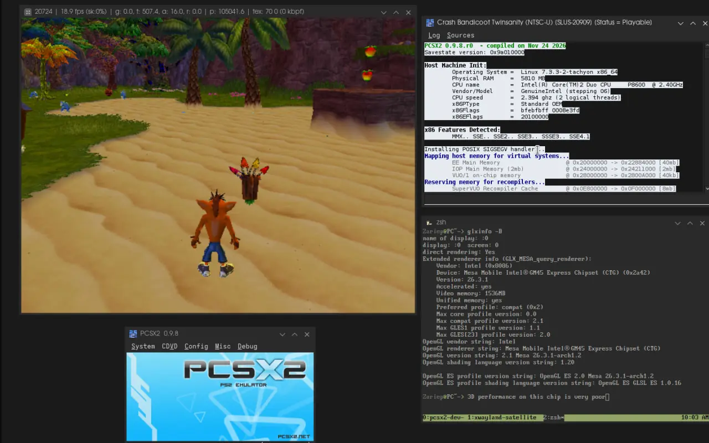

# PCSX2 0.9.8 for OpenGL 2.1 Hardware

Build scripts and compatibility patches to compile **PCSX2 0.9.8** (32-bit x86) inside a Debian Wheezy (`i386`) container and bundle it into a portable `AppDir` for modern Linux systems with older OpenGL 2.1 GPUs.

Tested on hardware such as **Intel Core 2 Duo P8600 + GMA 4500**, software is **Arch Linux x86_64** with lastest kernel, glibc, wayland/xwayland, etc.

<p align="center">


</p>

## Why This Exists

Modern PCSX2 versions require newer OpenGL capabilities and modern toolchains, while legacy 32-bit releases depend on older libraries that are awkward to piece together on current distros. This project provides a reproducible build environment and targeted source patches without bundling PCSX2's own source code.

This is obviously mostly aiming to play PS2 2D or very light 3D games because most GL2 class hardware would have a very poor 3D performance.

## Downloads

pre-built AppImages are available on [Releases page](https://github.com/ItsZariep/pcsx2-098-linux-appimage/releases), you can use `--appimage-extract` for a tarball-like set

## Requirements

### Build host
- `docker` (with `buildx` / multi-arch or `i386` emulation support as needed on your host)

### Runtime dependencies (Arch Linux, 32-bit)
```sh
sudo pacman -S --needed \
  lib32-mesa lib32-libx11 lib32-libxext lib32-libxxf86vm \
  lib32-alsa-lib lib32-libpulse lib32-libdrm lib32-libxdamage lib32-libxfixes
```

## Build

Builds are assisted by a Makefile


### Release

```sh
make
```

### Debug build (`Devel`)

Includes debug symbols and assertions:

```sh
make debug
```

To run with an automatic backtrace on crash:

```sh
PCSX2_GDB=1 ./out/PCSX2.AppDir/AppRun
```

The resulting bundle is written to `./out/PCSX2.AppDir`

### Package (AppImage)

```sh
make appimage
```


## Disclaimer

This repository contains only build scripts, runtime wrappers, and source patches. It does not distribute PCSX2 source code, binaries, or PlayStation 2 BIOS files.
